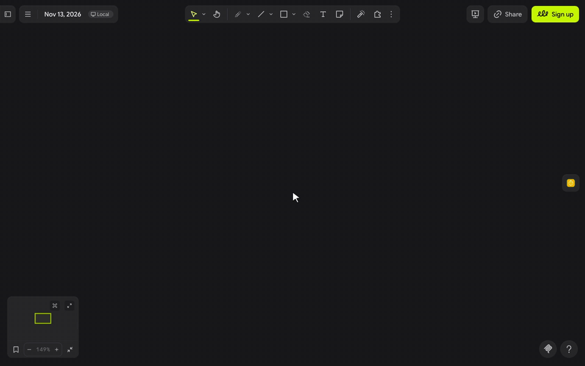

# Timer ⏱(｀・ω・´)

**keep the room on time.**

A countdown that lives on the board, so everyone in the session watches the same clock. Start a five-minute brainstorm and the timer ticks on every screen, even for people who don't have Timer, then chimes when time is up ✧

---

## let's time it ٩(◕‿◕)۶

1. Click the **stopwatch** in the extension rail. A timer lands in view.
2. Pick a length in the panel, _1_, _3_, _5_, _10_, _15_ or _25_ minutes, or type any whole number up to 99 in the box beside them. Add a **Label** like _Silent brainstorm_.
3. Press **Start** on the timer. Its digits and ring count down on every screen on the board.
4. **Pause**, **+1 min** and **Reset** sit on the timer, in the panel, and in the right-click menu under **Timer**.

> (・_・;) **Why didn't it chime?** Browsers only play sound after a click inside the panel. Press **Click to enable sound** once, or any button in the panel, and keep the board open in that tab.

---

## make it yours (｡•̀ᴗ-)✧

- **Sound when time is up**: Off, Soft or Bell, chosen on each device.
- **Label**: shows on the timer and on the pill, so everyone knows what the clock is for.
- **Length**: six presets plus your own, up to 99 minutes; **+1 min** keeps adding while it runs.
- **Size**: resize the timer like any element; it keeps its size through every press.
- **More than one timer**: the **+** in the panel adds another. Select a timer to set it up in the panel.

---

## little things to try (っ˘ω˘ς )

- Run a 5-minute silent brainstorm in a retro, then press **+1 min** when the room needs one more.
- Give each person 3 minutes in a design critique: **Reset**, **Start**, next person.
- Do a 25-minute focus sprint while you draw, with **Bell** so you hear it from across the room.
- Put a timer in each workshop section, labelled by activity, and start each one when its turn comes.

---

**the small print**: the timer is part of the board, so everyone on it sees the same countdown, and anyone with Timer can press its buttons; people without Timer see it tick but their clicks do nothing. A press swaps the timer for a fresh copy with the new state, so undoing one takes two steps. When the timer is off screen, a small pill at the top of your screen keeps counting. Each computer counts from its own clock, so screens can differ by a second or two. The panel's font, Google Sans Flex (OFL), loads from jsDelivr; nothing else downloads, and nothing you draw or type leaves your board. Your sound choice stays in this browser, and the chime is synthesised in it, with no audio files. Code [MIT](https://github.com/mickyngub/drawdy-timer/blob/main/LICENSE); building it yourself? See [DEVELOPMENT.md](https://github.com/mickyngub/drawdy-timer/blob/main/DEVELOPMENT.md).
